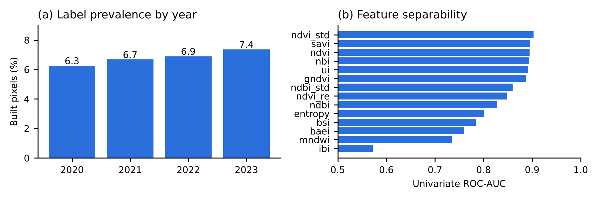

# UrbanMask observation base: Sentinel-2 pixel features and building labels, Goiânia 2020–2023

Pixel-level observation base used to train and validate the **UrbanMask** classifiers. UrbanMask flags new built surfaces in municipal public areas and vacant lots from Sentinel-2 imagery; its code is at https://github.com/ThiagoHF31/urbanMask.

The base holds **4,383,413 pixel-years**: about 1.1 million 10 m Sentinel-2 pixels per year, in 98,684 polygons of vacant lots in Goiânia, Brazil, from 2020 to 2023. Each pixel-year has:

- 14 spectral, texture and temporal features;
- the Google Open Buildings 2.5D Temporal building-presence score;
- a binary building label.

[](LICENSE)
[](LICENSE-CODE)

> **Source datasets.**
> - Labels derive from **[Google Open Buildings 2.5D Temporal](https://sites.research.google/gr/open-buildings/temporal)** (Google Research; Earth Engine `GOOGLE/Research/open-buildings-temporal/v1`; Sirko et al. 2023), which Google distributes under CC BY 4.0. A pixel-year is labelled built when the building presence is ≥ 0.56 and the building height is ≥ 2 m.
> - Features are computed from **Copernicus Sentinel-2** Level-2A harmonised surface reflectance (`COPERNICUS/S2_SR_HARMONIZED`), accessed through Google Earth Engine.
>
> See [`NOTICE`](NOTICE).

> **Privacy.** Polygons are identified only by an integer index. No lot code, owner, taxpayer, cadastral registration or address is included. Pixel coordinates are pixel centres at 10 m resolution, kept so that spatial blocking can be reproduced.

---

## Contents

```
.
├── data/
│   ├── pixels_2020.parquet ... pixels_2023.parquet   # one file per year (≈ 40 MB each, zstd)
├── docs/
│   ├── data_dictionary.md        # columns, types and units
│   └── features.md               # formulas of the 14 features and the labelling rule
├── scripts/
│   ├── build_release.py          # how the public files were derived from the raw extraction
│   └── analysis.py               # descriptive analysis -> results/
├── results/
│   ├── summary.md                # all descriptive statistics (generated)
│   ├── *.csv                     # tables used in summary.md
│   ├── figures/                  # prevalence, separability, correlation, class boxplots
│   └── model_validation/         # validation of the deployed classifiers (temporal, spatial, duplicates, rule)
├── CITATION.cff
├── NOTICE
├── LICENSE                       # CC BY 4.0 (data)
├── LICENSE-CODE                  # MIT (scripts)
└── requirements.txt
```

## Coverage

| Item | Value |
|---|---|
| Area | Vacant lots of the municipality of Goiânia, Goiás, Brazil (98,684 polygons) |
| Years | 2020, 2021, 2022, 2023 (annual composites) |
| Unit | Sentinel-2 pixel of 10 m × 10 m, one row per pixel and year |
| Size | 4,383,413 rows (1,095,810–1,095,945 per year), 22 columns |
| Reference system | WGS 84 (EPSG:4326), pixel centre coordinates |
| Label prevalence | 6.80% built overall; 6.26% (2020) → 7.37% (2023) |

## How the data were produced

1. **Pixel grid.** Each vacant-lot polygon was turned into a grid of points aligned to the 10 m Sentinel-2 pixel.
2. **Sentinel-2 composite (per year).**
   - Scenes from 1 January to 31 December with less than 20% cloud cover.
   - Cloud and cirrus masked with the QA60 band; reflectance scaled by 1/10,000.
   - Annual median composite.
3. **Features (14).**
   - 11 spectral indices computed on the median: NDVI, red-edge NDVI, GNDVI, SAVI, MNDWI, NDBI, UI, NBI, BSI, BAEI and IBI.
   - GLCM entropy of the near-infrared band (3 × 3 window).
   - The standard deviations of NDVI and NDBI across all valid scenes of the year.
   - Formulas are in [`docs/features.md`](docs/features.md).
4. **Label.** From Open Buildings 2.5D Temporal for the same year: `label_built = 1` if `building_presence ≥ 0.56` and `building_height ≥ 2 m`. The height filter removes compacted soil, pavements and rubble that look spectrally like buildings.
5. **De-duplication.** The raw extraction had 13,732,832 rows. Polygons that overlap or touch share pixels, so 68.1% of the rows repeated a pixel-year already present. The release keeps one row per pixel centre and year (`scripts/build_release.py`), which leaves 4,383,413 rows.

## Main characteristics

All values come from [`results/summary.md`](results/summary.md).

| Indicator | Value |
|---|---|
| Built pixel-years | 298,114 (6.80%) |
| New built pixels between consecutive years (0 → 1) | 1.26–2.51% of the unbuilt pixels per year |
| Unbuilt in 2020 and built in 2023 | 23,074 pixels (2.25% of the 2020 unbuilt pixels) |
| Label flicker (label changes two or more times in 2020–2023) | 3.25% of the pixels |
| Most separable features (univariate ROC-AUC) | `ndvi_std` 0.903, SAVI 0.896, NDVI 0.895, NBI 0.894, UI 0.891 |
| Strongest correlations | NDBI × BSI 0.98, NDBI × UI 0.97, NDVI × SAVI 0.97 |
| Spatial blocks (~3 km) | 75 blocks; built prevalence median 4.9% (IQR 2.3–9.4%) |



The label flicker reflects uncertainty in the Open Buildings Temporal product itself. Pixel-level labels are therefore a reference, not ground truth.

## Validation of the UrbanMask classifiers on this base

Summary of [`results/model_validation/`](results/model_validation/README.md), all on unique pixels:

| Protocol | Classifier | Precision | Recall |
|---|---|---:|---:|
| Train 2020–2022, test 2023 | PCA + Random Forest | 0.517 | 0.691 |
| Spatial blocks of ~3 km (5 folds, mean) | PCA + Random Forest | 0.492 | 0.665 |
| Time and space held out together | PCA + Random Forest | 0.521 | 0.650 |
| Random split, duplicates removed | PCA + Random Forest | 0.499 | 0.669 |
| Random split, duplicates kept (inflated) | PCA + Random Forest | 0.701 | 0.743 |
| Year 2023 | HEU rule (4 thresholds) | 0.453 | 0.355 |

- **Duplicates inflate random splits.** With duplicates kept, 68.4% of the test rows had a copy in the training set. Use spatial or temporal splits, for example with the `block_3km` and `year` columns.
- **Decision threshold is stable.** The optimal PCA + RF threshold stayed between 0.26 and 0.31 across protocols; the deployed value is 0.291.

## Usage

```python
import pandas as pd

df = pd.concat([pd.read_parquet(f"data/pixels_{y}.parquet") for y in range(2020, 2024)])
FEATURES = ["ndvi", "ndvi_re", "gndvi", "savi", "mndwi", "ndbi", "ui", "nbi",
            "bsi", "baei", "ibi", "ndvi_std", "entropy", "ndbi_std"]

# temporal hold-out: train on 2020–2022, test on 2023
train, test = df[df.year <= 2022], df[df.year == 2023]

# spatial hold-out: group k-fold on 3 km blocks
from sklearn.model_selection import GroupKFold
folds = GroupKFold(n_splits=5).split(df, groups=df.block_3km)
```

Reproduce the analysis:

```bash
pip install -r requirements.txt
python scripts/analysis.py
```

## Limitations

- **Domain.** Pixels come from vacant lots only. Built prevalence and the spectral background differ from other land types, such as public green areas.
- **Composites.** Training composites are annual medians. UrbanMask in operation uses a 150-day trailing median, so features computed in production are not identical.
- **Labels.** Labels come from a model, Open Buildings Temporal, which is itself derived from Sentinel-2; they are not field data. Agreement with them measures consistency with that product, not absolute accuracy.
- **Mixed pixels.** A 10 m pixel (100 m²) mixes buildings with their surroundings, and small extensions may not dominate a pixel.

## Licence and attribution

- **Data** (`data/`, `results/`): [CC BY 4.0](LICENSE).
- **Scripts:** [MIT](LICENSE-CODE).
- When reusing, also attribute the sources: *“Contains data from Google Open Buildings 2.5D Temporal (Google Research), CC BY 4.0, https://sites.research.google/gr/open-buildings/temporal, and modified Copernicus Sentinel-2 data (2020–2023).”*

## Related resources

- UrbanMask code and model: https://github.com/ThiagoHF31/urbanMask
- GYN-OBV, building-level visual validation of Open Buildings footprints in Goiânia: https://github.com/luizmlpascoal/geoinfo-dataset-gyn_obv

## Acknowledgements

Produced in the project *Inteligência Artificial Aplicada para promover uma Gestão eficiente do Dinamismo do Município de Goiânia*. The project runs under Convênio nº 4940406/2024 between the Municipality of Goiânia (Secretaria Municipal da Fazenda, SEFAZ) and the Universidade Federal de Goiás (UFG), through the Centro de Excelência em Inteligência Artificial (CEIA), with the Fundação de Apoio à Pesquisa (FUNAPE) as intervening party.

## References

- Sirko, W. et al. (2023). High-resolution building and road detection from Sentinel-2. arXiv:2310.11622. Dataset: https://sites.research.google/gr/open-buildings/temporal.
- Drusch, M. et al. (2012). Sentinel-2: ESA's optical high-resolution mission for GMES operational services. *Remote Sensing of Environment*, 120:25–36. doi:10.1016/j.rse.2011.11.026.
- Gorelick, N. et al. (2017). Google Earth Engine: planetary-scale geospatial analysis for everyone. *Remote Sensing of Environment*, 202:18–27. doi:10.1016/j.rse.2017.06.031.

## Contact

Luiz Mário Lustosa Pascoal, CEIA / Instituto de Informática, Universidade Federal de Goiás. luizmlpascoal@gmail.com
